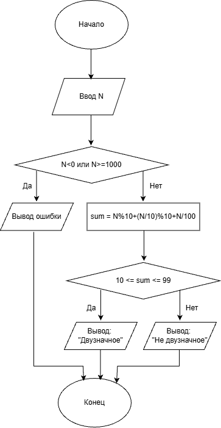

# Домашнее задание к работе 6

## Условие задачи

Составить программу, которая проверяет принадлежит ли заданная пользователем точка с координатами (х, у) заданным закрашенным (заштрихованным) областям, показанным на рисунках в табл., и выводит на экран сообщение.

## 1. Алгоритм и блок-схема
### Алгоритм
```
1. Начало
2. Ввести координаты точки x и y.
3. Проверить, выполняется ли условие x^2+y^2 <= 4, y >= x, x >= 0.
4. Если все условия выполняются, вывести сообщение «Точка принадлежит заданной области».
5. Иначе вывести сообщение «Точка не принадлежит заданной области».
6. Конец
```
### Блок-схема

## 2. Реализация программы
```
#define _CRT_SECURE_NO_WARNINGS
#include <stdio.h>
#include <locale.h>

int main()
{
    setlocale(LC_ALL, "RUS");

    double x, y;

    printf("Введите координаты x, y: ");
    scanf("%lf %lf", &x, &y);

    if (x * x + y * y <= 4 && y >= x && x >= 0)
    {
        printf("Точка принадлежит заданной области\n");
    }
    else
    {
        printf("Точка не принадлежит заданной области\n");
    }

    return 0;
}
```
### 3. Результаты работы программы
```
Введите координаты x, y: 1 1
Точка принадлежит заданной области

Введите координаты x, y: 2 1
Точка не принадлежит заданной области
```
### 4. Информация о разработчике

Дегтярева Полина, бИЦТ-262
